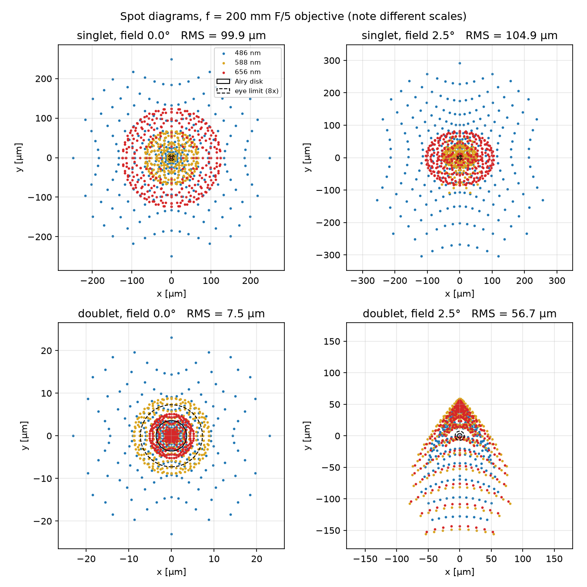
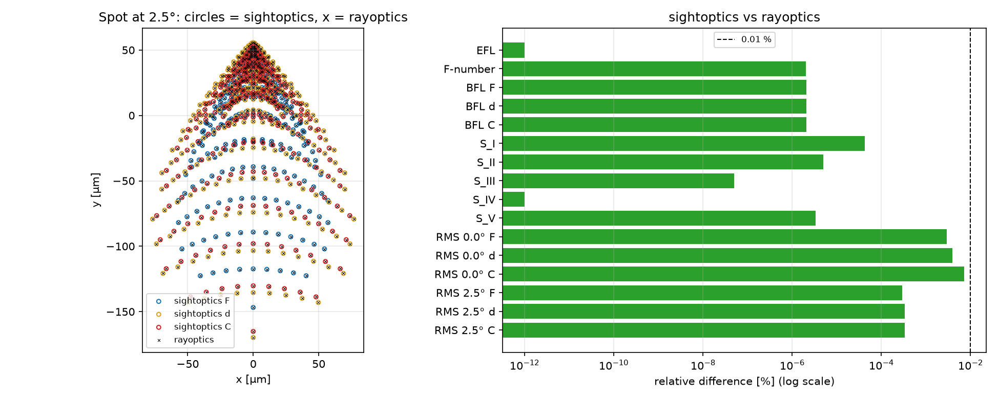
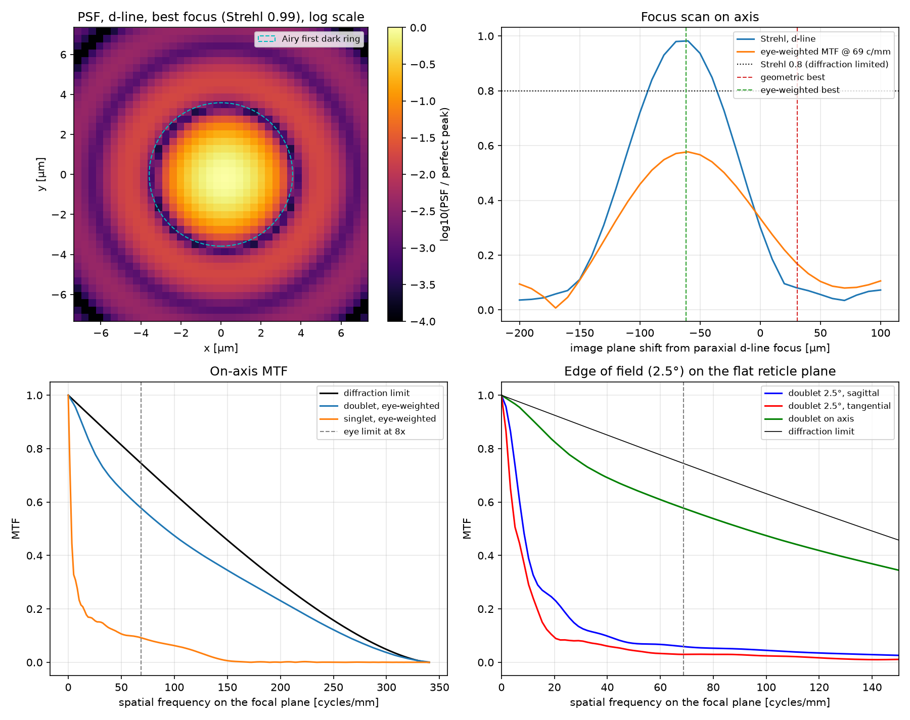
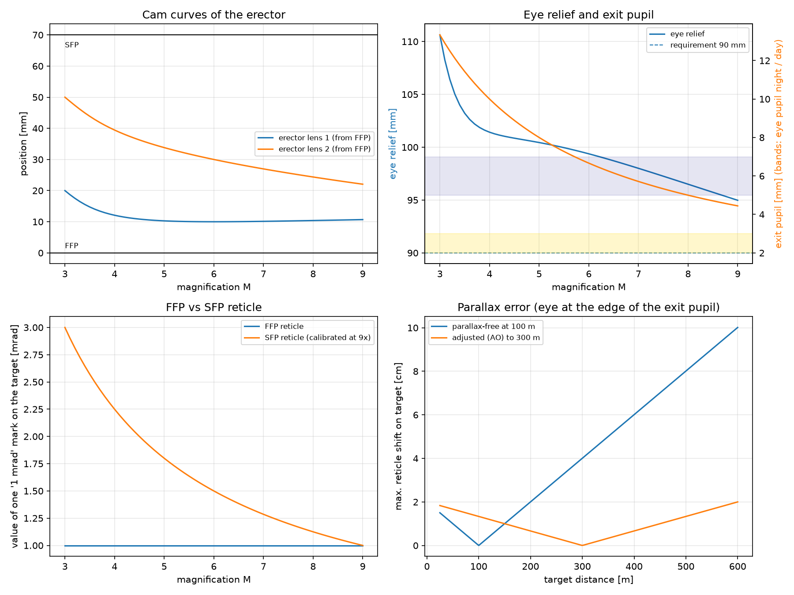
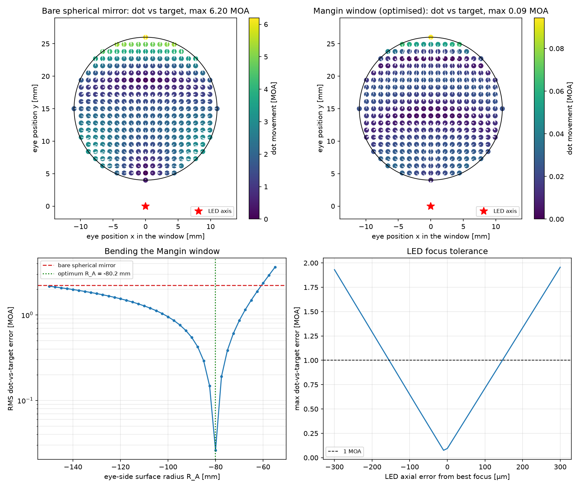
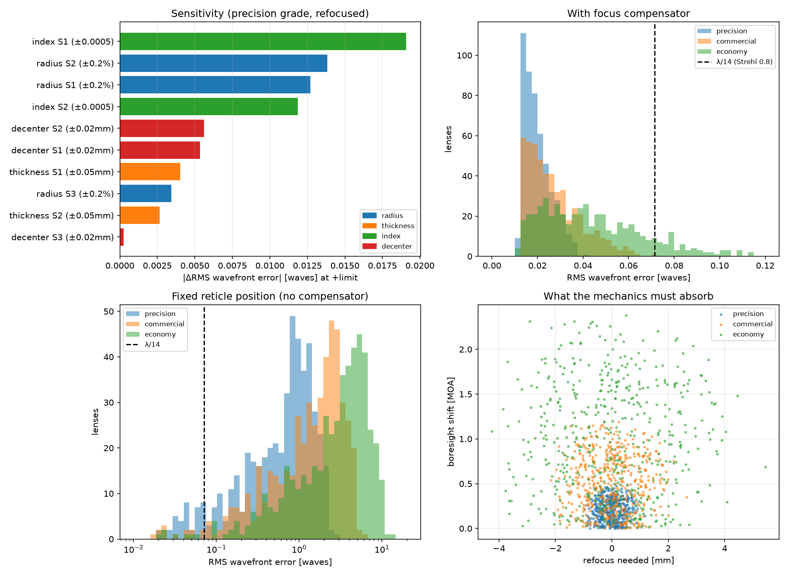

# sight-optics

[](https://github.com/SirPicklee/sight-optics/actions/workflows/tests.yml)

Optical design and analysis of weapon sights in Python, written from scratch:
paraxial and exact ray tracing, Seidel aberrations, achromat design, wave-optics MTF,
a 3-9x40 zoom rifle scope, a parallax-free reflex sight and Monte Carlo tolerancing.
The ray tracer is validated against the open-source [rayoptics](https://github.com/mjhoptics/ray-optics) package.

## Highlights

| | Result |
|---|---|
| Validation | Own ray tracer vs rayoptics: EFL, Seidel sums and ~1900 real rays agree to < 0.4 nm (0.007 %) |
| Speed | Vectorised numpy tracing ~100x faster than ray-by-ray tracing |
| 8x40 objective | Cemented N-BK7/N-F2 achromat, f = 200 mm F/5: Strehl 0.987 (λ/55 RMS) on axis |
| Focus choice | Eye-weighted focus gives 3.4x more contrast at the eye's limit than the geometric best focus |
| 3-9x40 rifle scope | Two-group zoom erector, eye relief 111-95 mm, FOV 13.0-4.3 m at 100 m |
| Reflex sight | Mangin window cuts parallax 95x vs a spherical mirror (18 cm -> 0.27 cm at 100 m) |
| Tolerancing | Focus compensator raises yield from 3 % to 100 % with commercial tolerances |

## What is inside

```
src/sightoptics/
  firstorder.py   Kepler telescope: magnification, exit pupil, eye relief, field of view
  paraxial.py     ABCD ray-transfer matrices, thick lenses, afocal systems
  raytrace.py     exact 3D sequential ray tracing (vector Snell's law), vignetting, decenter
  glass.py        Sellmeier dispersion (Schott N-BK7, N-F2), glass melt index offsets
  design.py       singlets, cemented achromats, colour correction, lens bending
  spot.py         spot diagrams, RMS spot, best focus, chromatic focal shift
  seidel.py       third-order aberrations, checked sign by sign against real rays
  wavefront.py    OPD on the reference sphere, PSF, Strehl, polychromatic eye-weighted MTF
  scope.py        variable-magnification scope: zoom cams, FFP/SFP reticle, parallax
  reflex.py       red-dot sight: mirror and Mangin windows, dot-vs-target parallax
  tolerance.py    sensitivity, RSS and Monte Carlo tolerance analysis with compensator
  interop.py      bridge to rayoptics for independent validation
tests/            100 tests (pytest), from Snell's law to Monte Carlo reproducibility
experiments/      exp01 ... exp10, one script per study, figures in results/
```

## Key findings

**Achromat (exp04, exp05).** A singlet has 3.1 mm of colour focal shift (f/V). The cemented doublet
removes it; two bendings give zero spherical aberration, and Seidel analysis shows why bending cannot fix
astigmatism and field curvature: they depend only on the lens powers.



**Seidel vs real rays (exp05).** In the third-order regime every Seidel term matches the exact ray trace
within 1 %. At full aperture spherical aberration differs by 4x: the optimiser balances third against
fifth order on purpose.

**Validation against rayoptics (exp06).** The remaining 0.38 nm difference is fully explained by the
object distance (1e10 mm in rayoptics vs infinity here).



**MTF and the eye (exp07).** The objective is diffraction limited (Strehl 0.987). Because of the secondary
spectrum, the reticle must sit at the eye-weighted focus, 61 µm in front of the paraxial focus: contrast
at the eye's limit (69 cycles/mm at 8x) is 0.58 there vs 0.17 at the geometric best focus.



**3-9x40 zoom scope (exp08).** A trade study picks the shortest layout with >= 90 mm eye relief at every
magnification. Clear-aperture analysis shows why rifle scopes have narrow apparent fields:
eyepiece radius ≈ ER·tan(AFOV/2) + EP/2.



**Reflex sight (exp09).** The optimiser does not make the dot perfect; it leaves a dot error that cancels
the prism effect of the thick window, so the error the shooter sees drops to 0.023 MOA RMS.



**Tolerancing (exp10).** The crown glass index and the first radii matter most because the crown is
2.3x stronger than the whole lens. Without a focus compensator even precision tolerances give 8 % yield;
with it, commercial tolerances give 100 %. RSS and Monte Carlo agree within 4 %.



## Run it

```bash
python -m venv .venv
source .venv/bin/activate          # Windows: .venv\Scripts\activate
pip install -e ".[dev]"
pytest -q
python experiments/exp07_mtf.py    # any experiment
```

The rayoptics cross-check is optional: `pip install -e ".[compare]"` (its tests are skipped otherwise).

## Limitations

- Spherical surfaces only (no aspheres), rotationally symmetric systems with y-decenter.
- The zoom scope is a first-order (thin-lens) layout; each lens would become a group in a real design.
- Stray light, coatings and thermal effects are not modelled.